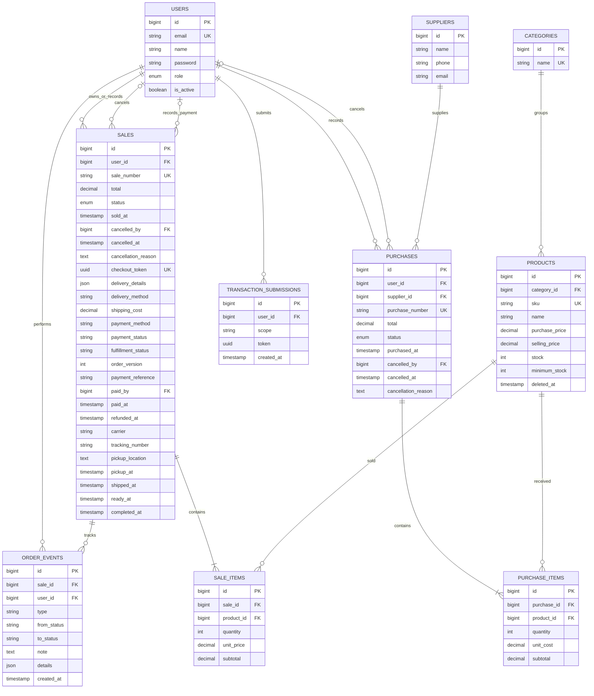

# Relasi data GRAIL.CO

Delapan tabel bisnis inti didampingi tabel pendukung Laravel, `transaction_submissions` untuk proteksi kiriman ganda, dan `order_events` untuk audit pesanan online.

`cancelled_by` dan kolom audit boleh kosong untuk transaksi lama. Produk diarsipkan melalui soft delete, sedangkan akun dinonaktifkan melalui `is_active`; detail transaksi tetap mengakses produk terarsip. Kombinasi `user_id`, `scope`, dan `token` unik pada tabel submission. Harga satuan dan subtotal disimpan pada detail saat transaksi dibuat; nota tidak mengambil harga jual terbaru.

Pada Sales, `user_id` adalah pemilik pesanan untuk checkout online atau petugas pencatat untuk penjualan kasir. Database saat ini belum menyimpan identitas pembeli terpisah pada transaksi kasir.

Checkout online menyimpan `checkout_token` unik untuk mengarahkan kiriman ulang ke nota yang sama. `delivery_details` menyimpan snapshot nama/telepon/email penerima, alamat bila dikirim, dan catatan. `total` pada checkout baru mencakup subtotal item ditambah `shipping_cost`. Metode pembayaran simulasi dicatat dengan `payment_status=pending`; kolom baru nullable pada transaksi lama/POS agar data historis tidak diubah atau dianggap sudah dibayar secara otomatis.

`fulfillment_status` terpisah dari status pencatatan transaksi. Pesanan online lama diisi pending/cancelled sesuai status transaksinya; POS tetap nullable. `order_version` berubah pada setiap aksi untuk menolak pembaruan dari halaman lama. `order_events` ditulis dalam transaksi yang sama dengan pembayaran/progres/void dan tidak memiliki endpoint edit/hapus. Waktu disimpan UTC, jadwal dan timeline ditampilkan WIB.
